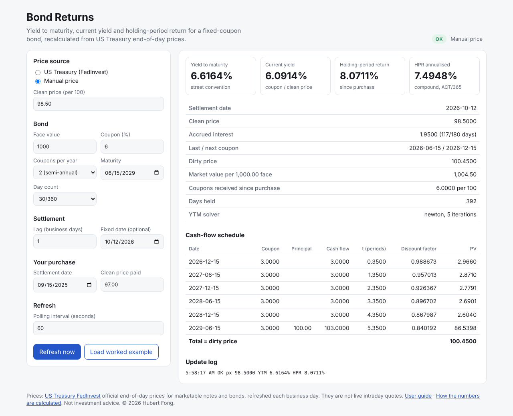

# Bond Returns

**See what a bond is really earning you.** Bond Returns works out the yield to maturity, current yield and holding-period return of a fixed-coupon bond. It keeps them up to date with official US Treasury prices, entirely in your browser.

**[Open the app →](https://hubertfong.github.io/bond-returns/)**



## What it does

- **Any US Treasury, by CUSIP.** Pick one of about 330 Treasury notes and bonds and its coupon, maturity and latest official price fill in.
- **Any other fixed-coupon bond, by hand.** Corporates, agencies, munis and non-US bonds work too: enter the terms and a price.
- **Your return to date.** Enter when you bought and what you paid, and see the price change, accrued interest and coupons received, both raw and annualised.
- **Numbers you can check.** The full cash-flow schedule is shown with the present value of every payment, and the payments add up to the price.
- **Always current.** The page refreshes on a timer, and a status badge says how fresh the price is.
- **Private by design.** There's no account and no server. Your inputs stay in your own browser.

## Quick start

**Use it:** open **[hubertfong.github.io/bond-returns](https://hubertfong.github.io/bond-returns/)**. The [user guide](docs/USER_GUIDE.md) explains every field and result in plain English.

**Run it on your computer** (needs [Node.js](https://nodejs.org) 22):

```bash
git clone https://github.com/HubertFong/bond-returns.git
cd bond-returns
npm ci
npm run dev            # then open http://localhost:5173/bond-returns/
```

Locally, the page uses a small sample price file, labelled as such on screen. Run `python python/fetch_fedinvest.py` to download the real prices.

## How it works

```
 US Treasury FedInvest                GitHub Actions (weekdays + every push)
 official end-of-day prices  ───►  fetch_fedinvest.py → treasury_prices.json
                                    tests → build → deploy → live smoke test
                                                       │
                                                       ▼
 Your browser  ◄─────────────────────────  GitHub Pages (static site + price file)
   reads the price file every 60 s and computes everything locally
```

There is no backend to run or pay for. Prices are collected by a scheduled GitHub Actions job and published with the site. The browser does all the maths.

## Documentation

| Read | If you want to |
|---|---|
| [User guide](docs/USER_GUIDE.md) | Use the app: fields, results, status badge, FAQ |
| [Method](docs/METHOD.md) | Check the maths: formulas, a worked example by hand, validation, edge cases |
| [Developer guide](docs/DEVELOPER.md) | Run, test, deploy, operate or extend the code |
| [Changelog](CHANGELOG.md) | See what is in each release |

## Accuracy

- **Published examples:** it matches Microsoft Excel's `PRICE` and `YIELD` functions on Microsoft's own documented examples.
- **Two independent implementations:** the maths exists twice, as a Python reference and a TypeScript port, and the two agree to within 0.000000001 on 962 test cases.
- **Tests on every change:** about 1,000 automated tests run on every change and before every deploy.

## Data and limits

- **Price source:** official end-of-day prices published by the US Treasury (FedInvest), refreshed each business day. They aren't live intraday quotes.
- **Automatic prices cover Treasury notes and bonds only.** Use a manual price for anything else. Bills, TIPS and floating-rate notes aren't supported.
- **Not modelled:** odd first or last coupons, ex-coupon periods, public-holiday calendars (weekends only), coupon reinvestment, taxes, and callable, amortising or floating-rate bonds.
- **Not investment advice.** Figures are for information only.

## Licence

Proprietary. Copyright © 2026 Hubert Fong. All rights reserved. See [LICENSE](LICENSE).
